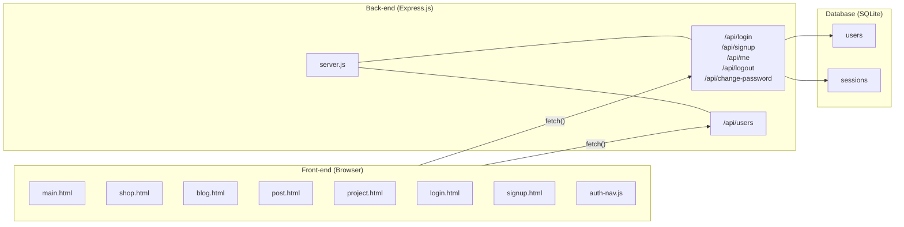
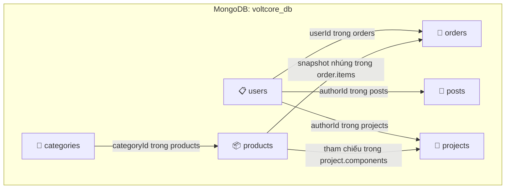
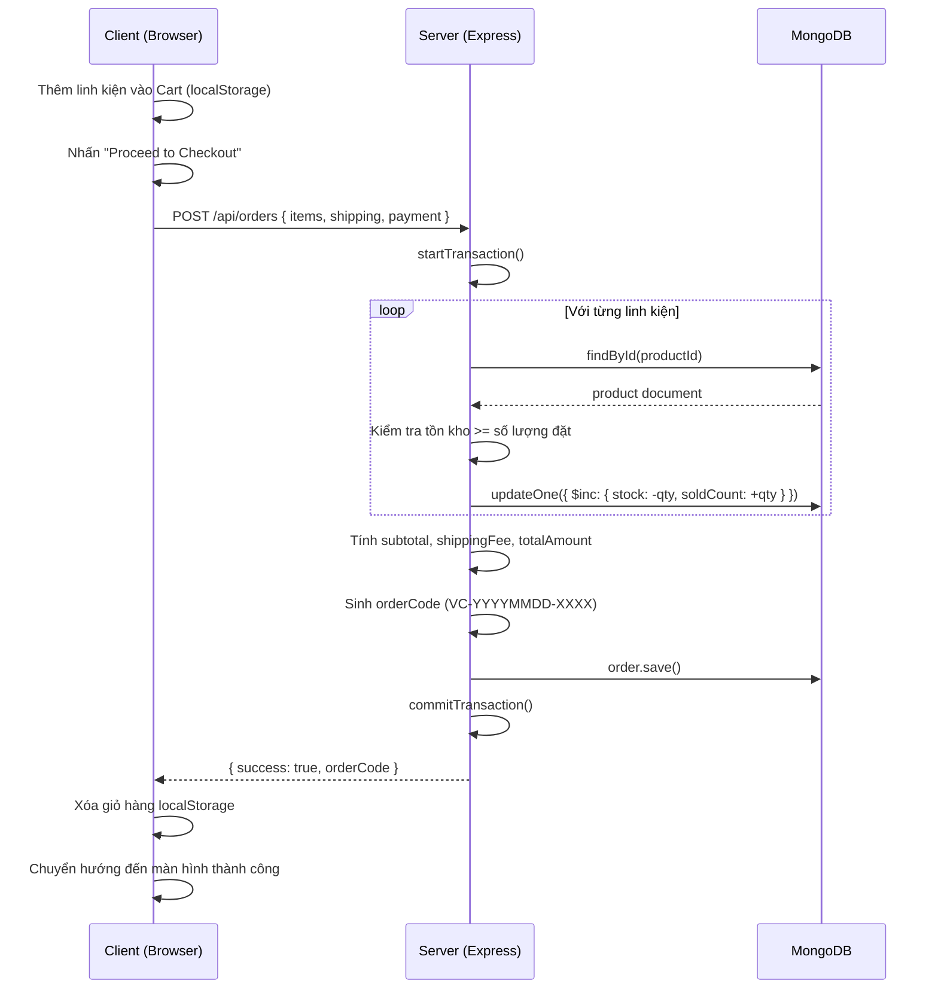
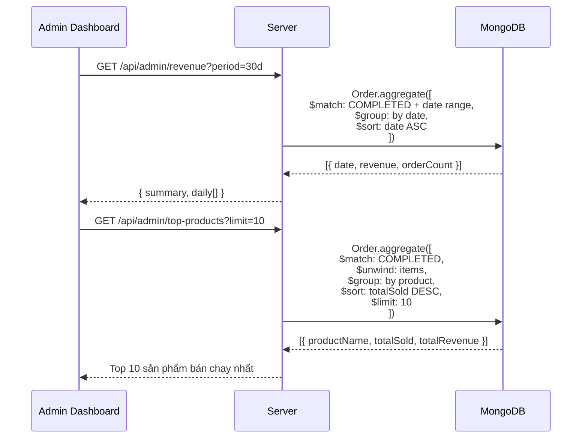

# ⚡ VOLTCORE — TÀI LIỆU TỔNG HỢP TOÀN DIỆN DỰ ÁN
> **Dự án Đồ án Cơ sở 2** — Trường Đại học Công nghệ Thông tin & Truyền thông Việt - Hàn (VKU)  
> **Sinh viên thực hiện**: Ngô Minh Quân (25IT165) & Phạm Sỹ Nguyên (25IT126) — Lớp: 25GIT1  
> **Giảng viên hướng dẫn**: ThS. Trần Đình Sơn  
> **Ngày cập nhật**: 03/11/2026

---

## 📑 MỤC LỤC
1. [Phần 1: Đề cương Đồ án Cơ sở 2 (Bản chuẩn)](#phần-1--đề-cương-đồ-án-cơ-sở-2)
2. [Phần 2: Đánh giá Dự án Hiện tại (Data Flow & Architecture)](#phần-2--đánh-giá-dự-án-hiện-tại)
3. [Phần 3: Thiết kế Kiến trúc Cơ sở Dữ liệu MongoDB](#phần-3--thiết-kế-kiến-trúc-cơ-sở-dữ-liệu-mongodb)
   - 3.1. [Tổng quan 6 Collections & Quan hệ](#31-tổng-quan-collections)
   - 3.2. [Chiến lược Nhúng (Embedded) vs Tham chiếu (Referenced)](#32-chiến-lược-embedded-vs-referenced)
   - 3.3. [Chi tiết Cấu trúc Document & Mongoose Schemas](#33-chi-tiết-document-schema)
4. [Phần 4: Chỉ mục (Indexes) & Quy tắc Ràng buộc (Validation)](#phần-4--indexes--validation-rules)
   - 4.1. [Bảng tổng hợp Indexes tối ưu hiệu năng](#41-tổng-hợp-indexes)
   - 4.2. [Quy tắc Validation (JSON Schema) tại mức Database](#42-validation-rules-json-schema)
5. [Phần 5: Mẫu Truy vấn & Aggregation Pipeline Phức tạp](#phần-5--mẫu-truy-vấn-queries-cho-các-tính-năng-phức-tạp)
   - 5.1. [Tìm kiếm & lọc sản phẩm nâng cao (Text Search + Filter + Sort)](#51-tìm-kiếm-sản-phẩm-full-text--filter--sort)
   - 5.2. [Xử lý đặt hàng Atomic & Transaction (Trừ kho an toàn)](#52-tạo-đơn-hàng-checkout--atomic-stock-update)
   - 5.3. [Thống kê doanh thu theo thời gian (Aggregation Pipeline)](#53-thống-kê-doanh-thu-theo-thời-gian-aggregation-pipeline)
   - 5.4. [Top sản phẩm bán chạy nhất](#54-top-sản-phẩm-bán-chạy)
   - 5.5. [Thống kê tổng quan Dashboard Realtime](#55-thống-kê-tổng-quan-dashboard-realtime-overview)
   - 5.6. [Đồng bộ giỏ hàng Server-side](#56-giỏ-hàng-đồng-bộ-server-side)
   - 5.7. [Tăng lượt xem bài viết nguyên tử](#57-tăng-lượt-xem-bài-viết-atomic)
6. [Phần 6: Sơ đồ Tuần tự Luồng Dữ liệu (Sequence Diagrams)](#phần-6--sơ-đồ-luồng-dữ-liệu-chính)
7. [Phần 7: Bảng Tóm tắt Quyết định Thiết kế](#phần-7--tóm-tắt-quyết-định-thiết-kế)

---

# Phần 1 — ĐỀ CƯƠNG ĐỒ ÁN CƠ SỞ 2

**TRƯỜNG ĐẠI HỌC CÔNG NGHỆ THÔNG TIN VÀ TRUYỀN THÔNG VIỆT - HÀN**  
**KHOA KHOA HỌC MÁY TÍNH**  
**CỘNG HOÀ XÃ HỘI CHỦ NGHĨA VIỆT NAM**  
*Độc lập - Tự do - Hạnh phúc*  
*Đà Nẵng, ngày 03 tháng 11 năm 2026*

### 1. Thông tin người thực hiện:
- **Sinh viên 1:** Ngô Minh Quân   |   **MSSV:** 25IT165   |   **Lớp:** 25GIT1  
  - Ngành: Công nghệ thông tin  
  - Điện thoại: 0702342997  
  - Email: `quannm.25it@vku.udn.vn`
- **Sinh viên 2:** Phạm Sỹ Nguyên   |   **MSSV:** 25IT126   |   **Lớp:** 25GIT1  
  - Ngành: Công nghệ thông tin  
  - Email: `nguyenps.25it@vku.udn.vn`
- **Giảng viên hướng dẫn:** ThS. Trần Đình Sơn

### 2. Tên đồ án:
**XÂY DỰNG WEBSITE THƯƠNG MẠI ĐIỆN TỬ LINH KIỆN ĐIỆN TỬ VÀ CHIA SẺ DỰ ÁN MAKER (VOLTCORE)**

### 3. Mô tả đề tài:
Xây dựng nền tảng web tích hợp thương mại điện tử chuyên ngành linh kiện điện tử (Vi điều khiển, Module IoT, Cảm biến, Phụ kiện Robotics) kết hợp diễn đàn kiến thức kỹ thuật và không gian chia sẻ các dự án mã nguồn mở cho cộng đồng kỹ sư/maker. Ứng dụng triển khai với kiến trúc **ReactJS (JSX Component-based)** phía giao diện người dùng, **Node.js/Express.js** phía máy chủ và hệ quản trị cơ sở dữ liệu phi quan hệ **MongoDB (NoSQL)**. Hệ thống giải quyết bài toán quản lý và lưu trữ thông số kỹ thuật đa dạng (Dynamic Specifications) của linh kiện điện tử, tự động hóa quy trình xử lý đơn hàng, theo dõi tồn kho nguyên tử và cung cấp bảng điều khiển trực quan (Admin Dashboard) phân tích doanh thu theo thời gian thực.

#### Kết quả dự kiến đạt được:
- **Đối với Khách vãng lai:**
  - Duyệt danh mục, tìm kiếm linh kiện theo từ khóa full-text, lọc theo mức giá và thương hiệu.
  - Xem chi tiết thông số kỹ thuật từng linh kiện (Điện áp, dòng điện, giao tiếp, sơ đồ chân).
  - Sử dụng giỏ hàng nhanh (Drawer Cart) lưu trữ tạm thời trên Client.
  - Đọc các bài viết hướng dẫn (Tutorials, Tips & Tricks), tra cứu mục lục động (TOC) và thanh tiến trình đọc.
  - Xem kho dự án Maker mẫu và mã nguồn demo.
- **Đối với Thành viên (Khách hàng đăng nhập):**
  - Đăng ký, đăng nhập an toàn, đổi mật khẩu, đồng bộ giỏ hàng từ LocalStorage lên tài khoản.
  - Thực hiện quy trình đặt hàng (Checkout), chọn địa chỉ nhận hàng và hình thức thanh toán (COD, Chuyển khoản).
  - Tra cứu lịch sử đơn hàng, xem trạng thái xử lý đơn (Chờ xử lý, Đang giao, Đã hoàn thành).
  - Quản lý danh sách địa chỉ giao hàng và danh sách sản phẩm yêu thích (Wishlist).
  - Đăng tải đóng góp dự án Maker của bản thân để chia sẻ với cộng đồng.
- **Đối với Quản trị viên (Chủ cửa hàng / Admin):**
  - Thực hiện toàn bộ quyền hạn của người dùng thông thường.
  - Quản lý kho hàng (CRUD sản phẩm, phân loại danh mục, cập nhật giá và tồn kho).
  - Quản lý đơn hàng: Tiếp nhận, xác nhận, chuyển trạng thái giao hàng và hủy đơn.
  - Quản lý tài khoản: Xem danh sách thành viên, khóa/mở khóa tài khoản khách.
  - Quản lý bài viết blog kỹ thuật (biên soạn, duyệt và xuất bản bài viết).
  - Báo cáo thống kê thời gian thực: Thống kê doanh thu theo ngày/tháng/năm, top sản phẩm bán chạy, sản phẩm sắp hết hàng thông qua MongoDB Aggregation Pipeline.

### 4. Nội dung thực hiện:
1. Gặp GVHD trao đổi ý tưởng và thống nhất công nghệ (ReactJS/JSX + Node.js + MongoDB NoSQL). Hoàn thiện và nộp đề cương chính thức.
2. Phân tích thiết kế hệ thống: Khảo sát luồng nghiệp vụ, vẽ sơ đồ Use Case, Activity Diagram và thiết kế Document Schema cho MongoDB.
3. Thiết kế và phát triển giao diện người dùng dựa trên cấu trúc JSX Components (Trang chủ, Cửa hàng, Giỏ hàng, Blog, Chi tiết bài viết, Dự án Maker).
4. Xây dựng Back-end API với Express.js: Cơ chế xác thực tài khoản (Bcrypt, Session/JWT), phân quyền vai trò (Customer / Admin).
5. Xây dựng phân hệ Cửa hàng và Đặt hàng: API tìm kiếm/lọc sản phẩm, xử lý đặt hàng với Transaction đảm bảo trừ kho nguyên tử.
6. Xây dựng phân hệ Quản trị (Admin Dashboard): Áp dụng MongoDB Aggregation Pipeline tổng hợp báo cáo doanh thu và sản phẩm bán chạy.
7. Đánh chỉ mục (Indexing) trong MongoDB nhằm tối ưu tốc độ truy vấn, kiểm thử toàn diện hệ thống (bảo mật, responsive) và tối ưu hiệu năng.
8. Hoàn thiện báo cáo đồ án cơ sở 2, chuẩn bị slide thuyết trình và nghiệm thu đề tài.

### 5. Kế hoạch thực hiện:

| Thời gian | Nội dung thực hiện | Phân công nhiệm vụ |
| :--- | :--- | :--- |
| **Tuần 1 - 2**<br>*(09/03 - 23/03)* | - Gặp GVHD trao đổi định hướng đề tài.<br>- Khảo sát yêu cầu bài toán, thống nhất công nghệ (ReactJS/JSX + NoSQL MongoDB).<br>- Hoàn thiện đề cương đồ án. | **Cả nhóm** |
| **Tuần 3**<br>*(24/03 - 30/03)* | - Nộp đề cương chính thức.<br>- **Phân tích thiết kế hệ thống:** Vẽ sơ đồ Use Case, Activity Diagram; thiết kế Document Schema cho MongoDB (`users`, `categories`, `products`, `orders`, `posts`, `projects`). | - **Minh Quân:** Vẽ Use Case, phân tích kiến trúc JSX Components.<br>- **Sỹ Nguyên:** Thiết kế Schema MongoDB, sơ đồ luồng dữ liệu. |
| **Tuần 4**<br>*(31/03 - 06/04)* | - Khởi tạo dự án ReactJS, cấu hình thư mục Component.<br>- Xây dựng các JSX Components cho Trang chủ và Cửa hàng (`Navbar`, `ProductCard`, `FilterTabs`, `CartDrawer`). | - **Minh Quân:** Phát triển UI/UX Shop & logic giỏ hàng phía Client.<br>- **Sỹ Nguyên:** Khởi tạo MongoDB, nạp seed data linh kiện mẫu, viết API lấy danh sách sản phẩm. |
| **Tuần 5**<br>*(07/04 - 13/04)* | - Xây dựng phân hệ Blog bằng JSX (`BlogList`, `PostDetail`, `TOC`, `ProgressBar`).<br>- Viết API quản lý bài viết trên Back-end và kết nối MongoDB. | - **Minh Quân:** Lập trình JSX cho trang Blog, xử lý lọc chuyên mục.<br>- **Sỹ Nguyên:** Xây dựng API quản lý bài viết, xử lý tăng lượt xem nguyên tử trên MongoDB. |
| **Tuần 6**<br>*(14/04 - 20/04)* | - Hoàn thiện Component trang Dự án Maker (`ProjectExplorer`, `TerminalCode`).<br>- Xây dựng cơ chế đăng nhập, xác thực phiên làm việc và phân quyền (Customer / Admin). | - **Minh Quân:** Lập trình giao diện trang Projects và modal đăng nhập.<br>- **Sỹ Nguyên:** Xử lý xác thực tài khoản, bảo mật phân quyền trong cơ sở dữ liệu. |
| **Tuần 7**<br>*(21/04 - 04/05)* | - Xây dựng luồng tạo đơn hàng (Checkout) và lưu vào Collection `orders` trong MongoDB.<br>- Đồng bộ giỏ hàng, trừ tồn kho tự động với Transaction. | - **Minh Quân:** Lập trình form thanh toán và xử lý giỏ hàng phía Client.<br>- **Sỹ Nguyên:** Xây dựng API tạo đơn hàng và cập nhật kho trong MongoDB. |
| **Tuần 8**<br>*(05/05 - 11/05)* | - Xây dựng phân hệ Quản trị (Admin Dashboard) với các JSX Component thống kê.<br>- Áp dụng **MongoDB Aggregation Pipeline** để phân tích số liệu doanh thu, sản phẩm bán chạy. | - **Minh Quân:** Thiết kế giao diện Dashboard Admin và biểu đồ thống kê.<br>- **Sỹ Nguyên:** Viết các truy vấn Aggregation tính toán doanh thu trên MongoDB. |
| **Tuần 9**<br>*(12/05 - 18/05)* | - Hoàn thiện các chức năng duyệt bài và quản lý kho trong Admin.<br>- Tạo **Index trong MongoDB** để tối ưu hóa tìm kiếm sản phẩm.<br>- Kiểm thử toàn diện hệ thống (Functionality & UI Responsive). | - **Minh Quân:** Kiểm thử giao diện, kiểm tra tính tương thích Responsive.<br>- **Sỹ Nguyên:** Đánh index MongoDB, kiểm tra an toàn dữ liệu và tối ưu API. |
| **Tuần 10**<br>*(19/05 - 26/05)* | - Khắc phục các lỗi phát hiện qua quá trình kiểm thử.<br>- Viết báo cáo thuyết minh đồ án cơ sở 2 chi tiết. | **Cả nhóm** |
| **Tuần kết thúc**<br>*(27/05 - 02/06)* | - Đóng gói mã nguồn (Source code) và dữ liệu MongoDB.<br>- Hoàn thiện báo cáo, nộp sản phẩm lên hệ thống của trường. | **Cả nhóm** |

---

# Phần 2 — ĐÁNH GIÁ DỰ ÁN HIỆN TẠI

### 2.1 Kiến trúc hiện tại của dự án


### 2.2 Những điểm đã làm tốt
1. **Luồng Xác thực (Auth flow):** Đăng ký, đăng nhập, đổi mật khẩu và đăng xuất đã vận hành qua Express + bcrypt + session.
2. **Module auth-nav.js:** Component tái sử dụng rất tốt — tự inject vào tất cả các trang, tự phát hiện Dark/Light theme, có modal quản lý tài khoản hoàn chỉnh.
3. **Giao diện Cửa hàng (Shop UI):** Drawer giỏ hàng hoàn chỉnh: thêm/xóa/sửa số lượng, tính tổng tiền, lưu trữ tạm qua `localStorage`.
4. **Blog & Post Detail:** Có bộ lọc theo chuyên mục, sắp xếp, tìm kiếm, bài viết chi tiết render động qua query slug, có mục lục tự động và thanh đo tiến trình đọc.
5. **Sơ đồ Use Case (`usecase.puml`):** Đã phân định rõ 3 Actor (Khách, Thành viên, Quản trị viên).

### 2.3 5 vấn đề cốt lõi cần khắc phục
1. **Dữ liệu linh kiện & bài viết đang hardcode trong HTML/JS:** 16 sản phẩm nằm cứng trong mảng `PRODUCTS` ở `shop.html`, 6 bài viết nằm trong `post.html`. Admin không thể CRUD nội dung nếu không sửa file code.
2. **Cơ sở dữ liệu đang dùng SQLite (`node:sqlite`):** Trái ngược với cam kết đồ án là dùng **MongoDB (NoSQL)**.
3. **Giỏ hàng chưa gắn với tài khoản:** Chỉ lưu tạm ở `localStorage`, mất dữ liệu khi đổi thiết bị; nút Checkout chỉ hiện thông báo tạm chưa có API tạo đơn.
4. **User Schema quá sơ sài:** Thiếu `role` (phân quyền admin), `phone`, `addresses`, `fullName`, `avatar`, `wishlist`.
5. **File `project.html` bị lỗi cắt cụt:** Dừng lại ở dòng 72 dù file CSS `prj.css` đã viết đầy đủ giao diện Terminal phong cách Maker.

---

# Phần 3 — THIẾT KẾ KIẾN TRÚC CƠ SỞ DỮ LIỆU MONGODB

### 3.1 Tổng quan Collections


### 3.2 Chiến lược Embedded vs Referenced

| Quan hệ dữ liệu | Chiến lược | Lý do kỹ thuật |
| :--- | :--- | :--- |
| **Order → Items** | **Embedded (Nhúng)** | Thông tin mua hàng cần là **Snapshot** bất biến tại thời điểm đặt (tên, giá, hình ảnh không đổi khi sản phẩm gốc thay đổi). Số lượng mặt hàng trong 1 đơn nhỏ (<50), luôn đọc cùng đơn hàng. |
| **User → Addresses** | **Embedded (Nhúng)** | Một tài khoản chỉ có tối đa 3-5 địa chỉ nhận hàng. Địa chỉ luôn cần nạp khi đặt hàng, không cần query độc lập. |
| **Post → TOC & Tags** | **Embedded (Nhúng)** | Luôn hiển thị cùng bài viết, cấu trúc nhỏ gọn. |
| **Product → Category** | **Referenced (Tham chiếu)** | Một danh mục chứa hàng trăm linh kiện. Khi đổi tên/icon danh mục chỉ cần update 1 document duy nhất. |
| **Order → User** | **Referenced (Tham chiếu)** | Một khách hàng phát sinh nhiều đơn qua thời gian. Tránh lặp thông tin tài khoản người dùng. |
| **Post / Project → Author** | **Referenced (Tham chiếu)** | Khi tác giả đổi avatar, tên hiển thị thì các bài viết tự động phản ánh thông tin mới qua lệnh `populate`. |
| **Product.specs** | **Embedded (Dynamic Mixed)** | **Lợi thế vượt trội của NoSQL:** Mỗi loại linh kiện (MCU, Cảm biến, Nguồn, Động cơ) có tập thông số hoàn toàn khác nhau, MongoDB lưu linh hoạt dưới dạng BSON Object mà không cần tạo hàng chục bảng phụ như SQL. |

---

### 3.3 Chi tiết Document Schema

#### 1. Collection `users`
```javascript
// models/User.js
const mongoose = require('mongoose');

const addressSchema = new mongoose.Schema({
  label:         { type: String, default: 'Nhà' },  // 'Nhà', 'Văn phòng'
  recipientName: { type: String, required: true },
  phone:         { type: String, required: true },
  province:      { type: String, required: true },
  district:      { type: String, required: true },
  ward:          { type: String },
  street:        { type: String, required: true },
  isDefault:     { type: Boolean, default: false }
}, { _id: true });

const userSchema = new mongoose.Schema({
  username: {
    type: String, required: true, unique: true,
    trim: true, minlength: 3, maxlength: 30,
    match: /^[a-zA-Z0-9_]+$/
  },
  email: {
    type: String, required: true, unique: true,
    lowercase: true, trim: true,
    match: /^[^\s@]+@[^\s@]+\.[^\s@]+$/
  },
  passwordHash: { type: String, required: true },
  fullName:     { type: String, trim: true, default: '' },
  phone:        { type: String, trim: true, default: '' },
  avatar:       { type: String, default: '' },
  role: {
    type: String,
    enum: ['customer', 'admin'],
    default: 'customer',
    index: true
  },
  addresses: {
    type: [addressSchema],
    validate: [arr => arr.length <= 5, 'Tối đa 5 địa chỉ']
  },
  wishlist: [{ type: mongoose.Schema.Types.ObjectId, ref: 'Product' }],
  isActive: { type: Boolean, default: true, index: true }
}, { timestamps: true });

userSchema.index({ username: 1 }, { unique: true });
userSchema.index({ email: 1 },    { unique: true });

module.exports = mongoose.model('User', userSchema);
```

*Mẫu Document JSON:*
```json
{
  "_id": "673d1a2b4f5e6a7890abcdef",
  "username": "minhquan_25it",
  "email": "quannm.25it@vku.udn.vn",
  "passwordHash": "$2a$10$kP3x...",
  "fullName": "Ngô Minh Quân",
  "phone": "0702342997",
  "avatar": "",
  "role": "admin",
  "addresses": [
    {
      "_id": "673d1a2b4f5e6a7890abc001",
      "label": "Nhà",
      "recipientName": "Ngô Minh Quân",
      "phone": "0702342997",
      "province": "Đà Nẵng",
      "district": "Ngũ Hành Sơn",
      "ward": "Hòa Hải",
      "street": "470 Trần Đại Nghĩa",
      "isDefault": true
    }
  ],
  "wishlist": ["673d1b0c4f5e6a7890abd001"],
  "isActive": true,
  "createdAt": "2026-10-10T10:00:00.000Z",
  "updatedAt": "2026-11-03T08:00:00.000Z"
}
```

---

#### 2. Collection `categories`
```javascript
// models/Category.js
const mongoose = require('mongoose');

const categorySchema = new mongoose.Schema({
  name:        { type: String, required: true, trim: true },
  slug:        { type: String, required: true, unique: true, lowercase: true },
  description: { type: String, default: '' },
  icon:        { type: String, default: '' },
  order:       { type: Number, default: 0 }
}, { timestamps: true });

categorySchema.index({ slug: 1 }, { unique: true });
categorySchema.index({ order: 1 });

module.exports = mongoose.model('Category', categorySchema);
```

---

#### 3. Collection `products`
```javascript
// models/Product.js
const mongoose = require('mongoose');

const productSchema = new mongoose.Schema({
  code: { type: String, required: true, unique: true, uppercase: true, trim: true },
  name: { type: String, required: true, trim: true },
  slug: { type: String, required: true, unique: true, lowercase: true },
  brand:    { type: String, required: true, trim: true },
  category: { type: mongoose.Schema.Types.ObjectId, ref: 'Category', required: true, index: true },
  price:    { type: Number, required: true, min: 0 },
  oldPrice: { type: Number, default: null },
  stock:    { type: Number, required: true, default: 0, min: 0 },
  images:     [{ type: String }],
  shortSpecs: { type: String, default: '' },
  // DYNAMIC SPECS: Lưu trữ linh hoạt thông số theo đặc thù từng linh kiện
  specs: { type: mongoose.Schema.Types.Mixed, default: {} },
  badge:      { type: String, enum: ['sale', 'hot', 'new', null], default: null },
  isFeatured: { type: Boolean, default: false, index: true },
  soldCount:  { type: Number, default: 0, min: 0 },
  isActive:   { type: Boolean, default: true }
}, { timestamps: true });

productSchema.index({ code: 1 }, { unique: true });
productSchema.index({ slug: 1 }, { unique: true });
productSchema.index({ name: 'text', brand: 'text', shortSpecs: 'text' });
productSchema.index({ category: 1, price: 1 });
productSchema.index({ badge: 1, isFeatured: 1 });
productSchema.index({ soldCount: -1 });

module.exports = mongoose.model('Product', productSchema);
```

*Mẫu Document JSON (Linh kiện Vi điều khiển - IoT):*
```json
{
  "_id": "673d1b0c4f5e6a7890abd001",
  "code": "ESP32S3",
  "name": "ESP32-S3-DevKitC-1",
  "slug": "esp32-s3-devkitc-1",
  "brand": "Espressif",
  "category": "673d1c004f5e6a7890abc100",
  "price": 185000,
  "oldPrice": 210000,
  "stock": 50,
  "images": ["img/ESP32-S3-DevKitC-1.png"],
  "shortSpecs": "Dual-core Wi-Fi + BT 5.0, 8MB PSRAM, USB-C",
  "specs": {
    "core": "Xtensa® 32-bit LX7 dual-core 240MHz",
    "flash": "8MB SPI",
    "psram": "8MB",
    "wifi": "802.11 b/g/n",
    "bluetooth": "Bluetooth 5 (LE)",
    "gpio": 44,
    "voltage": "3.3V",
    "interface": ["USB-C", "UART", "SPI", "I2C", "I2S", "PWM"]
  },
  "badge": "hot",
  "isFeatured": true,
  "soldCount": 128,
  "isActive": true
}
```

---

#### 4. Collection `orders`
```javascript
// models/Order.js
const mongoose = require('mongoose');

const orderItemSchema = new mongoose.Schema({
  product:  { type: mongoose.Schema.Types.ObjectId, ref: 'Product' },
  code:     { type: String, required: true },
  name:     { type: String, required: true },
  brand:    { type: String },
  image:    { type: String },
  price:    { type: Number, required: true },
  quantity: { type: Number, required: true, min: 1 }
}, { _id: false });

const statusHistorySchema = new mongoose.Schema({
  status:    { type: String, required: true },
  changedAt: { type: Date, default: Date.now },
  note:      { type: String, default: '' }
}, { _id: false });

const orderSchema = new mongoose.Schema({
  orderCode: { type: String, required: true, unique: true },
  user: { type: mongoose.Schema.Types.ObjectId, ref: 'User', default: null, index: true },
  shipping: {
    fullName: { type: String, required: true },
    phone:    { type: String, required: true },
    email:    { type: String },
    province: { type: String, required: true },
    district: { type: String, required: true },
    ward:     { type: String },
    street:   { type: String, required: true },
    note:     { type: String, default: '' }
  },
  items: {
    type: [orderItemSchema],
    validate: [arr => arr.length >= 1, 'Đơn hàng phải có ít nhất 1 sản phẩm']
  },
  itemCount:   { type: Number, required: true, min: 1 },
  subtotal:    { type: Number, required: true, min: 0 },
  shippingFee: { type: Number, default: 30000 },
  discount:    { type: Number, default: 0 },
  totalAmount: { type: Number, required: true, min: 0 },
  paymentMethod: {
    type: String,
    enum: ['COD', 'BANK_TRANSFER', 'MOMO'],
    default: 'COD'
  },
  paymentStatus: {
    type: String,
    enum: ['UNPAID', 'PAID'],
    default: 'UNPAID'
  },
  status: {
    type: String,
    enum: ['PENDING', 'CONFIRMED', 'SHIPPING', 'COMPLETED', 'CANCELLED'],
    default: 'PENDING',
    index: true
  },
  statusHistory: [statusHistorySchema],
  cancelReason: { type: String, default: '' }
}, { timestamps: true });

orderSchema.index({ orderCode: 1 }, { unique: true });
orderSchema.index({ createdAt: -1 });
orderSchema.index({ status: 1, createdAt: -1 });
orderSchema.index({ user: 1, createdAt: -1 });

module.exports = mongoose.model('Order', orderSchema);
```

---

#### 5. Collection `posts`
```javascript
// models/Post.js
const mongoose = require('mongoose');

const postSchema = new mongoose.Schema({
  slug:     { type: String, required: true, unique: true, lowercase: true },
  title:    { type: String, required: true, trim: true },
  category: {
    type: String,
    enum: ['Tutorials', 'Reviews', 'Technical', 'Tips & Tricks', 'AI & IoT', 'Projects'],
    required: true,
    index: true
  },
  author:       { type: mongoose.Schema.Types.ObjectId, ref: 'User', required: true },
  heroImg:      { type: String, default: '' },
  heroEmoji:    { type: String, default: '🔌' },
  heroGradient: { type: String, default: 'linear-gradient(135deg,#1a0d08,#2d1506)' },
  readTime:     { type: Number, default: 5 },
  views:        { type: Number, default: 0 },
  tags:         [{ type: String, trim: true }],
  toc:          [{ type: String }],
  content:      { type: String, required: true },
  isPublished:  { type: Boolean, default: false, index: true }
}, { timestamps: true });

postSchema.index({ slug: 1 }, { unique: true });
postSchema.index({ title: 'text', tags: 'text' });
postSchema.index({ isPublished: 1, createdAt: -1 });
postSchema.index({ category: 1, views: -1 });

module.exports = mongoose.model('Post', postSchema);
```

---

#### 6. Collection `projects`
```javascript
// models/Project.js
const mongoose = require('mongoose');

const projectSchema = new mongoose.Schema({
  slug:        { type: String, required: true, unique: true, lowercase: true },
  title:       { type: String, required: true, trim: true },
  author:      { type: mongoose.Schema.Types.ObjectId, ref: 'User', required: true },
  description: { type: String, required: true },
  difficulty:  { type: String, enum: ['beginner', 'intermediate', 'advanced'], default: 'intermediate' },
  components: [{
    product: { type: mongoose.Schema.Types.ObjectId, ref: 'Product' },
    name:    { type: String, required: true }
  }],
  codeSnippet: { type: String, default: '' },
  githubUrl:   { type: String, default: '' },
  tags:        [{ type: String }],
  views:       { type: Number, default: 0 },
  likes:       { type: Number, default: 0 },
  isApproved:  { type: Boolean, default: false, index: true }
}, { timestamps: true });

projectSchema.index({ slug: 1 }, { unique: true });
projectSchema.index({ isApproved: 1, createdAt: -1 });

module.exports = mongoose.model('Project', projectSchema);
```

---

# Phần 4 — INDEXES & VALIDATION RULES

### 4.1 Tổng hợp Indexes

| Collection | Index | Loại Index | Mục đích sử dụng |
| :--- | :--- | :--- | :--- |
| **users** | `{ username: 1 }` | Unique | Đăng nhập bằng username |
| **users** | `{ email: 1 }` | Unique | Đăng nhập bằng email, ngăn trùng |
| **users** | `{ role: 1 }` | Regular | Phân quyền truy cập Admin Dashboard |
| **categories** | `{ slug: 1 }` | Unique | Tra cứu danh mục theo URL slug |
| **products** | `{ code: 1 }` | Unique | Mã linh kiện định danh duy nhất |
| **products** | `{ slug: 1 }` | Unique | Đường dẫn SEO chi tiết sản phẩm |
| **products** | `{ name: 'text', brand: 'text', shortSpecs: 'text' }` | **Text** | Tìm kiếm full-text đa trường trên Search bar |
| **products** | `{ category: 1, price: 1 }` | Compound | Lọc linh kiện theo danh mục & sắp xếp giá |
| **products** | `{ soldCount: -1 }` | Regular | Lấy danh sách sản phẩm bán chạy nhất |
| **orders** | `{ orderCode: 1 }` | Unique | Tra cứu chi tiết đơn hàng theo mã |
| **orders** | `{ status: 1, createdAt: -1 }` | Compound | Quản trị viên lọc đơn theo trạng thái và thời gian |
| **orders** | `{ user: 1, createdAt: -1 }` | Compound | Khách hàng tra cứu lịch sử mua hàng của mình |
| **orders** | `{ createdAt: -1 }` | Regular | Thống kê doanh thu theo mốc thời gian |
| **posts** | `{ slug: 1 }` | Unique | Hiển thị nội dung bài viết theo URL slug |
| **posts** | `{ title: 'text', tags: 'text' }` | **Text** | Tìm kiếm bài viết theo từ khóa |
| **posts** | `{ isPublished: 1, createdAt: -1 }` | Compound | Danh sách bài viết đã kiểm duyệt mới nhất |
| **projects** | `{ slug: 1 }` | Unique | URL dự án maker cộng đồng |

### 4.2 Validation Rules (JSON Schema)
```javascript
// scripts/apply-validation.js — Thiết lập schema validation tại MongoDB Engine
db.createCollection('users', {
  validator: {
    $jsonSchema: {
      bsonType: 'object',
      required: ['username', 'email', 'passwordHash', 'role'],
      properties: {
        username: { bsonType: 'string', minLength: 3, maxLength: 30, pattern: '^[a-zA-Z0-9_]+$' },
        email:    { bsonType: 'string', pattern: '^[^\\s@]+@[^\\s@]+\\.[^\\s@]+$' },
        role:     { bsonType: 'string', enum: ['customer', 'admin'] }
      }
    }
  }
});

db.createCollection('products', {
  validator: {
    $jsonSchema: {
      bsonType: 'object',
      required: ['code', 'name', 'slug', 'brand', 'category', 'price'],
      properties: {
        code:  { bsonType: 'string', minLength: 1 },
        name:  { bsonType: 'string', minLength: 1 },
        price: { bsonType: 'number', minimum: 0 },
        stock: { bsonType: 'int', minimum: 0 },
        badge: { bsonType: ['string', 'null'], enum: ['sale', 'hot', 'new', null] }
      }
    }
  }
});

db.createCollection('orders', {
  validator: {
    $jsonSchema: {
      bsonType: 'object',
      required: ['orderCode', 'shipping', 'items', 'totalAmount', 'status'],
      properties: {
        orderCode:   { bsonType: 'string', minLength: 1 },
        totalAmount: { bsonType: 'number', minimum: 0 },
        status:      { bsonType: 'string', enum: ['PENDING', 'CONFIRMED', 'SHIPPING', 'COMPLETED', 'CANCELLED'] },
        paymentMethod: { bsonType: 'string', enum: ['COD', 'BANK_TRANSFER', 'MOMO'] },
        items: {
          bsonType: 'array', minItems: 1,
          items: {
            bsonType: 'object',
            required: ['name', 'price', 'quantity'],
            properties: {
              price:    { bsonType: 'number', minimum: 0 },
              quantity: { bsonType: 'int', minimum: 1 }
            }
          }
        }
      }
    }
  }
});
```

---

# Phần 5 — MẪU TRUY VẤN (QUERIES) CHO CÁC TÍNH NĂNG PHỨC TẠP

### 5.1 Tìm kiếm sản phẩm (Full-text + Filter + Sort)
```javascript
// routes/products.js — GET /api/products
async function searchProducts(req, res) {
  const { q, category, sort, page = 1, limit = 16 } = req.query;
  const skip = (page - 1) * limit;
  const filter = { isActive: true };

  // 1. Text search
  if (q && q.trim()) {
    filter.$text = { $search: q.trim() };
  }

  // 2. Lọc danh mục
  if (category && category !== 'all') {
    const cat = await Category.findOne({ slug: category });
    if (cat) filter.category = cat._id;
  }

  // 3. Sắp xếp
  let sortOption = {};
  switch (sort) {
    case 'price-asc':  sortOption = { price: 1 }; break;
    case 'price-desc': sortOption = { price: -1 }; break;
    case 'name':       sortOption = { name: 1 }; break;
    case 'best-sell':  sortOption = { soldCount: -1 }; break;
    default:
      if (filter.$text) sortOption = { score: { $meta: 'textScore' } };
      else sortOption = { createdAt: -1 };
  }

  const [products, total] = await Promise.all([
    Product.find(filter)
      .populate('category', 'name slug')
      .sort(sortOption)
      .skip(skip)
      .limit(Number(limit))
      .lean(),
    Product.countDocuments(filter)
  ]);

  res.json({ products, total, page: Number(page), totalPages: Math.ceil(total / limit) });
}
```

### 5.2 Tạo đơn hàng (Checkout) — Atomic Stock Update
```javascript
// routes/orders.js — POST /api/orders
async function createOrder(req, res) {
  const session = await mongoose.startSession();
  session.startTransaction();

  try {
    const { items, shipping, paymentMethod } = req.body;
    const orderItems = [];
    let subtotal = 0;

    for (const item of items) {
      const product = await Product.findById(item.productId).session(session);
      if (!product || !product.isActive) {
        throw new Error(`Sản phẩm "${item.productId}" không tồn tại.`);
      }
      if (product.stock < item.quantity) {
        throw new Error(`Sản phẩm "${product.name}" chỉ còn ${product.stock} trong kho.`);
      }

      // Trừ kho nguyên tử (Atomic decrement)
      await Product.updateOne(
        { _id: product._id, stock: { $gte: item.quantity } },
        { $inc: { stock: -item.quantity, soldCount: item.quantity } }
      ).session(session);

      subtotal += product.price * item.quantity;
      orderItems.push({
        product:  product._id,
        code:     product.code,
        name:     product.name,
        brand:    product.brand,
        image:    product.images[0] || '',
        price:    product.price, // Snapshot giá lúc mua
        quantity: item.quantity
      });
    }

    // Sinh mã đơn hàng tự động VC-YYYYMMDD-XXXX
    const today = new Date().toISOString().slice(0, 10).replace(/-/g, '');
    const count = await Order.countDocuments({
      createdAt: { $gte: new Date(new Date().setHours(0, 0, 0, 0)) }
    }).session(session);
    const orderCode = `VC-${today}-${String(count + 1).padStart(4, '0')}`;

    const shippingFee = 30000;
    const totalAmount = subtotal + shippingFee;

    const order = new Order({
      orderCode,
      user: req.session.userId || null,
      shipping,
      items: orderItems,
      itemCount: orderItems.reduce((sum, i) => sum + i.quantity, 0),
      subtotal,
      shippingFee,
      totalAmount,
      paymentMethod: paymentMethod || 'COD',
      status: 'PENDING',
      statusHistory: [{ status: 'PENDING', note: 'Đơn hàng mới tạo' }]
    });

    await order.save({ session });
    await session.commitTransaction();

    res.status(201).json({ success: true, orderCode, totalAmount });
  } catch (err) {
    await session.abortTransaction();
    res.status(400).json({ error: err.message });
  } finally {
    session.endSession();
  }
}
```

### 5.3 Thống kê doanh thu theo thời gian (Aggregation Pipeline)
```javascript
// routes/admin/stats.js — GET /api/admin/revenue
async function dailyRevenue(req, res) {
  const thirtyDaysAgo = new Date();
  thirtyDaysAgo.setDate(thirtyDaysAgo.getDate() - 30);

  const data = await Order.aggregate([
    // Bước 1: Chỉ lấy các đơn hàng đã hoàn tất trong 30 ngày qua
    { $match: { status: 'COMPLETED', createdAt: { $gte: thirtyDaysAgo } } },
    // Bước 2: Gom nhóm theo ngày
    { $group: {
      _id: { $dateToString: { format: '%Y-%m-%d', date: '$createdAt' } },
      revenue:    { $sum: '$totalAmount' },
      orderCount: { $sum: 1 },
      itemsSold:  { $sum: '$itemCount' }
    }},
    // Bước 3: Sắp xếp theo ngày tăng dần
    { $sort: { _id: 1 } },
    // Bước 4: Định dạng đầu ra
    { $project: { _id: 0, date: '$_id', revenue: 1, orderCount: 1, itemsSold: 1 } }
  ]);

  const summary = data.reduce((acc, d) => ({
    totalRevenue: acc.totalRevenue + d.revenue,
    totalOrders:  acc.totalOrders + d.orderCount,
    totalItems:   acc.totalItems + d.itemsSold
  }), { totalRevenue: 0, totalOrders: 0, totalItems: 0 });

  res.json({ summary, daily: data });
}
```

### 5.4 Top sản phẩm bán chạy
```javascript
// GET /api/admin/top-products
async function topSellingProducts(req, res) {
  const data = await Order.aggregate([
    { $match: { status: 'COMPLETED' } },
    { $unwind: '$items' },
    { $group: {
      _id: '$items.product',
      productName:  { $first: '$items.name' },
      productCode:  { $first: '$items.code' },
      brand:        { $first: '$items.brand' },
      image:        { $first: '$items.image' },
      totalSold:    { $sum: '$items.quantity' },
      totalRevenue: { $sum: { $multiply: ['$items.price', '$items.quantity'] } }
    }},
    { $sort: { totalSold: -1 } },
    { $limit: 10 },
    { $project: { _id: 0, productId: '$_id', productName: 1, productCode: 1, brand: 1, image: 1, totalSold: 1, totalRevenue: 1 } }
  ]);

  res.json(data);
}
```

### 5.5 Thống kê tổng quan Dashboard Realtime Overview
```javascript
// GET /api/admin/overview
async function dashboardOverview(req, res) {
  const today = new Date();
  today.setHours(0, 0, 0, 0);

  const [
    totalProducts, lowStockCount, totalUsers, totalOrders,
    pendingOrders, todayOrders, todayRevenue, totalRevenue
  ] = await Promise.all([
    Product.countDocuments({ isActive: true }),
    Product.countDocuments({ isActive: true, stock: { $lte: 5 } }),
    User.countDocuments({ role: 'customer', isActive: true }),
    Order.countDocuments(),
    Order.countDocuments({ status: 'PENDING' }),
    Order.countDocuments({ createdAt: { $gte: today } }),

    Order.aggregate([
      { $match: { status: 'COMPLETED', createdAt: { $gte: today } } },
      { $group: { _id: null, total: { $sum: '$totalAmount' } } }
    ]).then(r => r[0]?.total || 0),

    Order.aggregate([
      { $match: { status: 'COMPLETED' } },
      { $group: { _id: null, total: { $sum: '$totalAmount' } } }
    ]).then(r => r[0]?.total || 0)
  ]);

  res.json({
    totalProducts, lowStockCount, totalUsers, totalOrders,
    pendingOrders, todayOrders, todayRevenue, totalRevenue
  });
}
```

### 5.6 Giỏ hàng đồng bộ Server-side
```javascript
// POST /api/cart/sync — Gọi ngay sau khi User đăng nhập
async function syncCart(req, res) {
  const { items } = req.body;
  if (!items || !items.length) return res.json({ cart: [] });

  const productIds = items.map(i => i.productId);
  const products = await Product.find({ _id: { $in: productIds }, isActive: true }).lean();

  const validCart = items.map(item => {
    const p = products.find(x => x._id.toString() === item.productId);
    if (!p) return null;
    return {
      productId: p._id,
      name:      p.name,
      brand:     p.brand,
      image:     p.images[0] || '',
      price:     p.price,
      stock:     p.stock,
      quantity:  Math.min(item.quantity, p.stock)
    };
  }).filter(Boolean);

  res.json({ cart: validCart });
}
```

### 5.7 Tăng lượt xem bài viết Atomic
```javascript
// GET /api/posts/:slug
async function getPost(req, res) {
  const post = await Post.findOneAndUpdate(
    { slug: req.params.slug, isPublished: true },
    { $inc: { views: 1 } },
    { new: true }
  ).populate('author', 'username fullName avatar');

  if (!post) return res.status(404).json({ error: 'Bài viết không tồn tại' });
  res.json(post);
}
```

---

# Phần 6 — SƠ ĐỒ LUỒNG DỮ LIỆU CHÍNH

### 6.1 Luồng Đặt hàng (Checkout Flow)


### 6.2 Luồng Thống kê Doanh thu (Admin Aggregation)


---

# Phần 7 — TÓM TẮT QUYẾT ĐỊNH THIẾT KẾ

| Quyết định kiến trúc | Lý do lựa chọn |
| :--- | :--- |
| **Phân tách 6 collections rõ ràng** | Đảm bảo tính đóng gói của từng domain, phân quyền độc lập, duy trì kích thước document dưới 16MB. |
| **Embedded cho `order.items`, `order.shipping`** | Bảo toàn dữ liệu lịch sử giá và tên sản phẩm tại thời điểm mua (Snapshot), tăng tốc độ truy xuất hóa đơn không cần join. |
| **Referenced cho `product.category`, `post.author`** | Tránh trùng lặp dữ liệu lớn, hỗ trợ cập nhật danh mục và thông tin tác giả tập trung 1 nơi. |
| **Trường `specs` kiểu `Mixed`** | Cho phép lưu linh hoạt hàng chục thông số kỹ thuật khác biệt cho từng họ linh kiện điện tử — ưu thế của NoSQL so với SQL. |
| **Text Index đa trường** | Đảm bảo tính năng tìm kiếm nhanh trên thanh Search Bar mà không cần triển khai thêm Elasticsearch. |
| **Compound Index `{ status, createdAt }`** | Tối ưu hóa truy vấn lọc và phân trang hóa đơn trên Admin Dashboard. |
| **Transaction ACID khi Checkout** | Đảm bảo an toàn dữ liệu tồn kho: chỉ trừ kho thành công mới tạo hóa đơn, nếu lỗi thì hoàn tác toàn bộ. |
